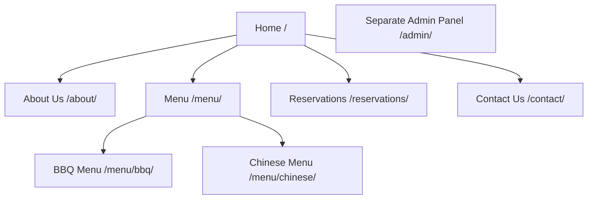

# Karachi Food House

A complete HTML5, CSS3 and vanilla JavaScript restaurant website for the Technical SEO practical assignment. All restaurant details and prices are illustrative. No installation, build process, external fonts or remote image requests are needed.

## Run locally

Open this project folder in VS Code. With Python installed, run in the project root:

```bash
python -m http.server 8000
```

Visit `http://localhost:8000/`. Alternatively, use VS Code Live Server. Serve the project root so folder URLs such as `/menu/bbq/` resolve to their `index.html` files. Keep the whole folder together. The assignment domain `https://example.com` is a placeholder, not an actual deployment.

## Project structure and routes

| File | Practice URL |
| --- | --- |
| `index.html` | https://example.com/ |
| `about/index.html` | https://example.com/about/ |
| `menu/index.html` | https://example.com/menu/ |
| `menu/bbq/index.html` | https://example.com/menu/bbq/ |
| `menu/chinese/index.html` | https://example.com/menu/chinese/ |
| `reservations/index.html` | https://example.com/reservations/ |
| `contact/index.html` | https://example.com/contact/ |
| `admin/index.html` | https://example.com/admin/ |
| `assets/css/styles.css` | Shared responsive styling |
| `assets/js/main.js` | Mobile navigation and demo form validation |
| `assets/images/bbq-platter.svg` | Local BBQ illustration |
| `assets/images/chow-mein.svg` | Local Chinese food illustration |
| `sitemap.xml` | Public URL discovery |
| `robots.txt` | Crawler directives |
| `README.md` | Assignment documentation and running instructions |
| `SEO-VERIFICATION.md` | Verification results and limits |

## Website hierarchy



The header and footer connect the public pages. The Menu dropdown exposes both categories, and breadcrumbs on category pages link back to Menu and Home. No public page links to Admin; access the practice dashboard directly at `/admin/`.

## sitemap.xml

```xml
<?xml version="1.0" encoding="UTF-8"?>
<urlset xmlns="http://www.sitemaps.org/schemas/sitemap/0.9">
  <url><loc>https://example.com/</loc></url>
  <url><loc>https://example.com/about/</loc></url>
  <url><loc>https://example.com/menu/</loc></url>
  <url><loc>https://example.com/menu/bbq/</loc></url>
  <url><loc>https://example.com/menu/chinese/</loc></url>
  <url><loc>https://example.com/reservations/</loc></url>
  <url><loc>https://example.com/contact/</loc></url>
</urlset>
```

## robots.txt

```text
User-agent: *
Allow: /
Disallow: /admin/

Sitemap: https://example.com/sitemap.xml
```

## How the SEO pieces work together

The directory structure establishes each page's URL. Navigation and breadcrumbs let visitors and crawlers move between related pages. The sitemap lists exactly the seven public canonical URLs, helping search engines discover them. robots.txt allows public crawling, asks compliant crawlers not to crawl `/admin/`, and points to the root sitemap.

robots.txt is NOT access control, and a disallow rule does not guarantee that a URL will never appear in search results. The admin page also includes a `noindex, nofollow` meta tag, but crawlers blocked by robots.txt may not fetch the page to see that tag. A real admin panel requires server-side authentication and authorization; this demo implements neither and contains no private records.

## Demo functionality

- Responsive layouts with breakpoints at 1000px and 760px.
- Mobile menu button with expanded-state announcements and Escape-to-close.
- Native Menu dropdown and breadcrumb navigation.
- Required fields, email validation and past-date prevention on reservations.
- Accessible labels and live feedback for both forms.
- Explicit demo-only confirmation: no table is booked and no message is sent.
- No network submission or browser storage of form data.
- Form buttons are disabled until JavaScript loads; navigation remains usable without JavaScript.
- Static admin sections for Menu Management, Reservations, Customers and Settings.
- Original local SVG food illustrations; no third-party asset dependency.

## Verification

See `SEO-VERIFICATION.md` for all 16 requested checks. Static link, metadata, XML and robots checks passed, alongside JavaScript syntax and interaction checks using a DOM mock. A real browser was unavailable, so visual rendering and native browser form behavior still require a manual check.
